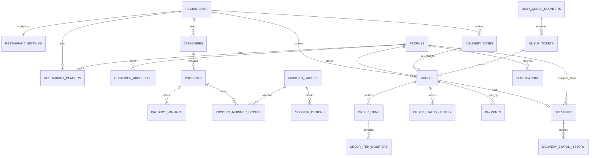

# Database ERD and Data Ownership

The SQL files under `supabase/migrations` are the schema source of truth. Hibernate uses `ddl-auto: validate` and must not create or modify the schema.

## Entity relationship overview

## Important constraints and invariants

- **Multi-restaurant isolation:** catalog, orders and delivery zones carry `restaurant_id`. Composite foreign keys in the SQL schema enforce same-restaurant relationships where defined.
- **Authentication and profiles:** Supabase Auth owns `auth.users`; `public.profiles.id` references the Auth user ID. The migration `20261022001000_sync_auth_user_profiles.sql` creates/backfills profile rows. Customer-facing endpoints derive profile/customer IDs from the validated JWT subject.
- **Restaurant roles:** `restaurant_members` uniquely associates one user with one restaurant and a role. Application permissions are computed from the server-side role mapping, not from client-provided IDs or role claims.
- **Saved addresses:** `customer_addresses.user_id` references a profile. Address CRUD queries additionally scope by the authenticated user ID. Address data is snapshotted on an order at checkout.
- **Prices:** monetary values are whole-unit `BIGINT` values. Prices, modifiers, delivery fees and order totals are computed server-side. `orders.total_amount` must equal `subtotal + delivery_fee - discount_amount`.
- **Customer delivery checkout:** a delivery order references a valid zone for the same restaurant. Active-zone selection and minimums are checked on the server. The current schema does not encode geographic boundaries for zones.
- **Delivery:** one `deliveries` row per order. The default driver is stored at `restaurant_settings.default_delivery_driver_user_id`, which references a profile; the service validates that the configured user is a `DELIVERY_DRIVER` member of that same restaurant.
- **Queues:** daily queue numbers are scoped through `daily_queue_counters` per restaurant and date. Common QR tracking stores a hash of a high-entropy token, not its raw value.
- **Status audit:** order and delivery changes create separate history records. Delivery state transitions synchronize the associated order state within a transaction.
- **RLS:** RLS stays enabled on the tables covered by the migrations. The backend performs authorization checks even when connecting through trusted server-side database credentials.

## Migration workflow

1. Add new schema changes as a new timestamped file; do not edit an already-applied migration.
2. Inspect `npx supabase migration list` and `npx supabase db push --dry-run` before applying any migration.
3. Run `npx supabase db push` only after confirming the pending migrations are the intended changes.
4. Run `mvn --batch-mode -f app/api/pom.xml clean verify` to validate the Java model and tests against the migration-backed schema.
