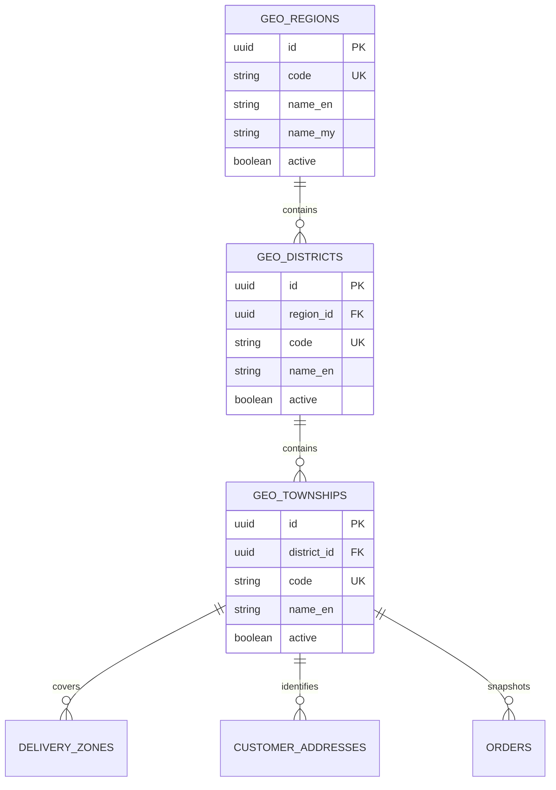

# Geographic master data and canonical delivery addresses

The previous implementation stored city/township strings separately in saved addresses and delivery zones. Case-insensitive text matching could not establish a geographic identity or validate a district/region chain. Operations and checkout now use read-only global Region → District → Township data and canonical Township UUIDs; detailed street/contact data remains editable and coordinates remain optional.



All three identity columns on address, zone and new order snapshots are validated by composite PostgreSQL foreign keys. Legacy identity columns remain nullable as a complete set. Active names are unique within their immediate parent, never globally unique by township name. Existing order histories/snapshots are not rewritten. Separate triggers protect the new geographic snapshot columns from subsequent edits. Indexed tenant/township zone queries preserve different restaurant fees for the same township.

## Reviewed source and import audit

Reference source: [CareNet import.sql](https://github.com/waiyanphyo-max/CareNet_Backend/blob/main/src/main/resources/import.sql), Git blob `bd247b556f7d77d407abceea159752e1183b4a73`, captured in `docs/data/carenet-geography-v1.sql`. The reference Region, District and Township entities establish the parent relationships; their User/branchAdmin relationships are intentionally excluded.

`node scripts/geography-import.cjs` parses an allowlisted INSERT grammar; it never executes the source SQL. Unknown statements, duplicate source IDs and invalid parent IDs fail before generation. `node --test scripts/geography-import.test.cjs` covers parsing and invalid data. UUIDv5 identifiers include a project namespace, source version, entity kind and source ID. Codes such as `carenet-v1-township-290` identify source records; they are **not official administrative codes**. The generated migration checks for ID/name/code collisions instead of overwriting an existing entity. Repeating the seed migration is harmless when the same source identities already exist.

The audit contains 15 regions, 85 districts and 323 source township records, zero invalid parents, 43 whitespace repairs and 5 duplicate pairs. The duplicate groups are Thayet (source IDs 120/121), Tada-U (125/126), Pyigyidagun (133/134), Wundwin (138/139) and Yamethin (152/153). All ten duplicate rows retain distinct IDs but remain inactive pending platform review, leaving 313 selectable townships. No ambiguous records are merged. `docs/geography-import-audit.json` records duplicates, cross-district homonyms, normalizations and review warnings; `docs/geography-source-mapping.json` maps every original ID and spelling to its deterministic new identity and activation decision.

Administrative boundaries and transliterations are **unverified source-era data**. In particular the four-district Yangon grouping must not be advertised as a verified current administrative map. All boundaries require review against an authorized current source before production rollout. Missing entities and Burmese translations have not been inferred. A follow-up reviewed migration can deactivate/correct records without reusing identities or changing old order snapshots.

## API contracts

Public read-only API endpoints (curated global DTOs; direct database access remains restricted):

- `GET /api/v1/locations/regions`
- `GET /api/v1/locations/regions/{regionId}/districts`
- `GET /api/v1/locations/districts/{districtId}/townships`

Each returns an array of `{id,code,nameEn,nameMy,regionId,districtId}` with unused parent IDs null. Lists sort by case-folded English name then ID. Responses use `Cache-Control: max-age=3600, private`. Missing/inactive parents return `404 LOCATION_PARENT_NOT_FOUND`; malformed UUIDs return 400. Inactive records and descendants of inactive parents are excluded. There are no create/update/delete endpoints. RLS and revoked DML privileges prohibit reference-data writes by authenticated, anonymous and service-role API clients; future maintenance requires an explicitly privileged platform migration/workflow.

Customer address requests append `regionId,districtId,townshipId,recipientPhone`; responses append these plus `regionName,districtName`. `houseNo,street,ward,deliveryNote,recipientName` retain their current names. Labels `city,township` remain backward-compatible response fields, populated from the hierarchy for new address writes.

Delivery zone requests append `regionId,districtId,townshipId`; responses append these and `regionName,districtName`. Name, fee, minimum order, active state, tenant ownership and authorization are preserved. New zones require canonical coverage. Updating fees/activity from an old client with omitted coverage preserves existing identity. Explicit empty or unrecognized text cannot create unrestricted coverage.

Temporary checkout destinations append `regionId,districtId,townshipId,ward,street,houseNo`; legacy `address,city,township` remain available. Quote destination snapshots append the identity chain plus `regionName,districtName,ward,street,houseNo`. Server-side lookup validates the entire active chain and supplies all authoritative names; provided labels cannot override IDs. The full formatted address includes details, township, district and region. Saved address phone may be overridden for a specific checkout. New orders persist the canonical identity, names and individual detailed components alongside the complete existing human-readable snapshot. Customer order details expose those snapshot fields too.

Customer-visible delivery-zone responses also include canonical IDs and region/district names, enabling the checkout UI to recognize configured canonical coverage. New orders created through the older delivery endpoint retain a separate immutable `delivery_township_name` snapshot: this supplies the existing `deliveryTownship` response field without manufacturing quote keys or changing old checkout-metadata constraints. `deliveryCity` similarly falls back to the captured region name. Original historical city/township labels take precedence whenever present.

Township coverage is preliminary eligibility. Operations handlers must inspect ward/street details before accepting and may cancel within the existing fulfillment/financial rules. No distance, geocoding or reachability claim is inferred.

## Forward-only migration and compatibility sequence

1. Preserve/apply the already existing `20261116090000_allow_text_only_customer_delivery_checkout.sql` change first.
2. Apply `20261116100000_add_geographic_master_data.sql` to add tables, indexes, read-only policies, nullable identities and immutable snapshot columns.
3. Review audit/source mapping, then apply `20261116101000_seed_myanmar_geography_v1.sql`.
4. Apply `20261116102000_report_legacy_geographic_locations.sql`: uniquely identifiable zone records gain IDs only; all original zone labels, fees and states remain intact. Existing customer addresses and orders remain untouched.
5. Export `SELECT * FROM public.legacy_geographic_location_review` through an authorized platform database workflow for review. The view exposes original text, candidate count and candidate Township UUIDs for legacy addresses/unmapped zones, including ambiguous and unmatched cases. It is not granted to customer/restaurant roles. Do not export customer data into source control.
6. Have owners correct ambiguous/unmatched zones and customers explicitly review/select locations on old addresses. An exact unique match can support checkout without silently editing the saved address. Customer address IDs remain null until the customer saves the reviewed choice.
7. Deploy the backend only after all three migrations, then ship mobile clients. Existing backend code is compatible with the nullable additive columns. Old mobile clients can continue exact unique region/township requests; administrative suffixes Region/State/Union Territory may be omitted. No fuzzy matching, transliteration guesses or city-to-region invention occurs. Unknown/ambiguous/inactive labels produce an actionable selection error. Old arbitrary coverage and unrestricted legacy zones cannot pass canonical checkout.
8. Leave identity fields nullable until remediation and old-client support are formally retired; add any future required constraints in a separate reviewed migration. Historical orders retain nullable legacy identities permanently.

The backend still validates COD quote confirmation, request hashes/idempotency, owned addresses, cart prices, minimum orders, stock and tenant authorization. A quote includes canonical IDs and the full snapshot in its confirmation digest, so changing identity/address data requires a new review. Receipt recovery remains independent of mutable reference/location labels. No payment collection or delivery completion is performed by geographic resolution.

## Local verification and device checklist

Use only a disposable loopback database named `accounting_verify`. The local verification for this change used PostgreSQL 16.4 on `127.0.0.1:55487`, with bootstrap/migration evidence under ignored `target/geo-qa-20261116`. For PG16 only, temporary copies of two old baseline migrations omit PostgreSQL 17's `MAINTAIN` keyword; repository migrations are unchanged. New migrations themselves run unchanged.

```powershell
$env:JAVA_HOME='C:\tools\jdk21'
$env:PATH="$env:JAVA_HOME\bin;$env:PATH"
$maven='C:\Users\DELL\.m2\wrapper\dists\apache-maven-3.9.9-bin\4nf9hui3q3djbarqar9g711ggc\apache-maven-3.9.9\bin\mvn.cmd'
$env:ACCOUNTING_TEST_DATABASE_URL='jdbc:postgresql://127.0.0.1:55487/accounting_verify'
& $maven -o -B --no-transfer-progress -f app/api/pom.xml '-Dtest=GeographicLocationLocalPostgresTest,CustomerDeliveryLocalPostgresTest,DeliveryCancellationLocalPostgresTest' test
node --test scripts/geography-import.test.cjs
```

On both Android apps select Yangon Region → East Yangon → Tamwe; verify searching, loading, retry, empty states and that changing a parent clears descendants. Save a no-GPS address with ward/street/building and recipient phone; use both saved and temporary destinations at `san-thaw-tar`. Verify supported/unsupported township quotes, mismatched IDs rejected by the API, zone-specific fees/minimums, COD confirmation/retry recovery and immutable customer order history. Check an old ambiguous address prompts review. Confirm Operations can inspect full address/item snapshots before accepting and unrelated restaurants/drivers cannot view customer details. These are real-device checks, separate from automated verification.
