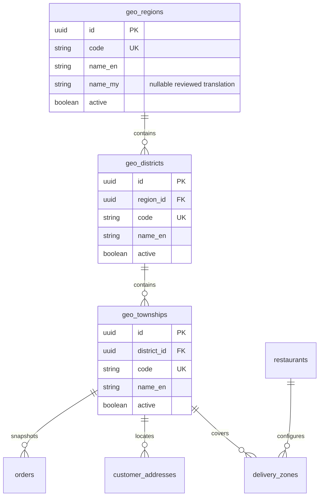

# Myanmar locations, Operations orders, and customer confirmation

Implemented on `rebuild/build-for-device-testing`, preserving the existing local text-only checkout, delivery UI, Postman, documentation and staged restaurant configuration changes. No commit, push, deployment, hosted migration or hosted Auth setting change was performed.

## Architecture and causes

Delivery zones and addresses previously carried independent city/township strings. Eligibility depended on matching those strings, so spelling and ambiguous names could disagree. The new global reference tables use deterministic UUIDs and foreign keys. Public reference GETs provide selectable data, restaurant members retain tenant-scoped zone configuration, and customer address/checkout services resolve and validate the entire hierarchy. Coverage is matched by Township ID. A township match is preliminary eligibility; a restaurant still reviews ward/street/building before accepting.

Order lists previously returned totals and status without item or destination snapshots. They now batch-load the page's immutable item/modifier snapshots and include a delivery destination only for restaurant order handlers with the explicit delivery-details permission. Dedicated drivers retain assigned-task access. Neither a public menu nor an unrelated restaurant obtains customer contacts. History is loaded only on detail requests.

The former manual status chain made kitchen work unnecessarily repetitive. A separate domain command now records one atomic transition for Accept, Complete or Cancel while retaining the historical status API for older clients. Order/restaurant locks, status expectation checks, notifications, stock evidence, queue transitions and delivery handoff rules remain enforced.

Signup previously omitted `emailRedirectTo`; Supabase used its global Site URL. Customer confirmation now selects a build-scoped destination and returns to sign-in without importing an external session. The optional stable HTTPS callback provides an installed-app handoff and missing-app fallback. See [exact Auth configuration](customer-email-confirmation.md).

## Database relationships



Composite foreign keys on address, zone and order location triples enforce the declared district/region chain. Legacy triples may remain entirely null; partial triples are rejected. Active township names are unique within a district, never globally. Codes identify the pinned source record and are not claimed to be official administrative codes. Reference RLS/privileges allow reads and deny application-role writes. Future maintenance requires an explicitly authorized platform migration/workflow.

## Import audit and review

The pinned CareNet source blob is `bd247b556f7d77d407abceea159752e1183b4a73`. Only geographic INSERT data was parsed; no CareNet user/branch relationships or runtime import execution was copied.

| Audit | Result |
| --- | --- |
| Regions/states | 15 |
| Districts | 85 |
| Source township rows | 323 |
| Selectable township rows | 313 |
| Same-district duplicate pairs | 5; all 10 source rows retained inactive |
| Whitespace-normalized names | 43 |
| Invalid parent references | 0 |
| Source-to-UUID mappings | 423 |

Review [the full audit](geography-import-audit.json), [explicit mapping](geography-source-mapping.json), and [pinned geographic input](data/carenet-geography-v1.sql). The generator is `scripts/geography-import.cjs`; its tests cover duplicate/invalid IDs and parents, deterministic IDs and migration output. Repeated seed execution leaves existing identities unchanged and detects conflicting identities. Duplicates are quarantined, never silently merged. No Burmese names or missing entities were invented.

The CareNet administrative boundaries and transliterations remain unverified historical reference data. In particular, the Yangon grouping and every other source-era boundary require current authoritative review before a production rollout. Source labels such as `Tamwe` must not be silently substituted for another spelling absent reviewed data.

## Forward migration and rollout order

Apply all prior migrations first, including the user's existing `20261116090000_allow_text_only_customer_delivery_checkout.sql`. Then review/apply in order:

1. `20261116100000_add_geographic_master_data.sql` — read-only hierarchy, nullable canonical columns, integrity constraints and immutable order snapshot trigger.
2. `20261116101000_seed_myanmar_geography_v1.sql` — audited deterministic seed and identity collision checks.
3. `20261116102000_report_legacy_geographic_locations.sql` — unique zone identity backfill and platform-only review view.

Deploy the new backend after the schema/seed, then publish the mobile JavaScript/apps. Configure and host the stable confirmation fallback before enabling its URL in release builds. Do not send new clients to an older backend: its location endpoints, canonical snapshots and action commands do not exist. A failed deployment should roll back application code only to a version compatible with the expanded schema; preserve all forward migrations and stored data.

Older Android clients retain the old status endpoint and text request fields. The updated backend resolves legacy region/township text only to an exact unique canonical match, allowing case/outer-space normalization and a region administrative suffix. It never creates geography or fuzzily guesses a township. Ambiguous, absent or inactive data fails with `CANONICAL_LOCATION_REQUIRED`; these clients need location remediation or an upgrade. Legacy zones with confidently unique matches receive identity columns without changing their original labels/fees. Unmatched zones cannot authorize canonical checkout until an owner selects the hierarchy.

Existing customer address text is never changed automatically. The platform-only `legacy_geographic_location_review` view lists unique candidates requiring review, ambiguous records and unmatched records with candidate township IDs. An authorized reviewer can inspect the candidate chain; customers can open Profile, edit the saved address and explicitly choose the canonical hierarchy. Historical orders and their original snapshots are never backfilled or relabelled. New orders preserve canonical identity, structured detail and a complete human-readable address snapshot. A separate immutable township-name snapshot also supports the older delivery-creation route while retaining the existing confirmed-checkout metadata constraints.

## API contracts

| Route | Contract |
| --- | --- |
| `GET /api/v1/locations/regions` | Sorted active reference array |
| `GET /api/v1/locations/regions/{id}/districts` | Active children of active region; invalid/inactive parent rejected |
| `GET /api/v1/locations/districts/{id}/townships` | Active children of active district/region; invalid/inactive parent rejected |
| Reference DTO | `id, code, nameEn, nameMy, regionId, districtId`; no sensitive data; one-hour private caching |
| Existing customer address create/update/read | Adds `regionId, districtId, townshipId, regionName, districtName, recipientPhone`; detail/contact fields and optional coordinates remain |
| Existing delivery-zone create/update/read | Adds hierarchy IDs and names; existing restaurant ownership, active, fee and minimum remain |
| Existing delivery quote/checkout | Temporary destination adds hierarchy IDs, `ward, street, houseNo`; server validates IDs and derives labels; saved addresses retain ownership validation |
| Quote destination | Canonical IDs/names, complete formatted address, structured details, normalized recipient phone, optional coordinates, source and saved-address identity |
| Existing paged member order list/detail | Adds item/modifier snapshots and permission-filtered destination; summaries omit status/payment history |
| `POST /api/v1/restaurants/{restaurantId}/orders/{orderId}/actions` | `{ action: "ACCEPT" | "COMPLETE" | "CANCEL", expectedStatus, reason? }`; cancellation needs a meaningful reason |

The quote token covers the server-resolved destination and current cart/fees. Issued checkout keys, confirmed quote validation, stock checks, tenant scope, COD pending-payment creation, duplicate submission prevention and receipt recovery continue to run server-side. Neither client-supplied labels nor Maps coordinates establish delivery eligibility. No Google Maps key or fabricated coordinates are needed.

## Meaning of the three order actions

| Order type | Accept | Complete | Physical/financial follow-up |
| --- | --- | --- | --- |
| Delivery | PENDING → ACCEPTED | ACCEPTED/PREPARING → READY | Separate assignment, pickup → OUT_FOR_DELIVERY, delivered → COMPLETED; explicit COD cash confirmation |
| Takeaway/Common QR with queue ticket | PENDING → ACCEPTED | ACCEPTED/PREPARING → READY | Existing queue calling/confirmed pickup finishes the order; payment remains separate |
| Takeaway/counter without queue | PENDING → ACCEPTED | ACCEPTED/PREPARING → COMPLETED | Existing cash collection stays separate; unpaid remains unpaid |
| Table/DINE_IN/Table QR without queue | PENDING → ACCEPTED | ACCEPTED/PREPARING → COMPLETED | Payment/receipt workflow stays separate |
| Existing historical READY non-delivery | Existing status retained | Eligible existing completion/pickup transition | No manufactured intermediate histories |
| Cancelled/completed or dispatched delivery | No kitchen action | No kitchen action | Details/history remain readable to authorized handlers |

The general orders UI presents Accept, Complete and Cancel as primary processing actions. Confirmation copy explains handoff versus fulfillment. Delivery drivers retain their distinct pickup, delivered, failure and cash-confirmation actions. Complete never creates a delivered event or marks a COD/counter payment paid.

Cancellation requires restaurant scope, valid transition, authorization and a 10–500 character reason. Staff receive only narrow early unpaid cancellation, not refund or dispatched-order authority. Owners/managers use the established financial rules; settled/collected payments require refund review. Pending delivery payments close atomically. Proven delivery reservations release only before preparation; preparation-stage stock is retained, and historical missing reservation evidence remains auditable. Terminal-state and lock checks prevent duplicate stock release or payment disposition. Status/history/queue changes and customer notifications share the transaction. Practical-service-area cancellation can use `Delivery address outside our practical service area.`

## Verification and device acceptance

Automated counts and evidence are recorded in [verification results](location-orders-auth-verification.md). The complete working-tree [changed-file inventory](location-orders-auth-files.md) distinguishes the pre-existing local work from files added/extended for this request. Existing tracked migration files remain unchanged.

No real Android device, email inbox or hosted Supabase acceptance is claimed. Required manual scenarios include a branded `san-thaw-tar` customer and operations build, region/district cascading search and retry, saved-address remediation, temporary text COD quote/confirmation/recovery, supported/unsupported/mismatched township, fee/minimum checks, staff/private-detail role boundaries, full item/modifier/address cards, Accept/Complete/Cancel, queue pickup, delivery assignment/COD completion, and successful/expired/wrong-tenant/missing-app email returns.

## Windows PowerShell runbook

Run from `C:\RestaurantManagementSystem\Restaurant-Platform`. Keep existing local environment files private and retain their approved development configuration.

```powershell
$env:JAVA_HOME = 'C:\tools\jdk21'
$env:PATH = "$env:JAVA_HOME\bin;$env:PATH"
$maven = 'C:\Users\DELL\.m2\wrapper\dists\apache-maven-3.9.9-bin\4nf9hui3q3djbarqar9g711ggc\apache-maven-3.9.9\bin\mvn.cmd'
npm run build:packages
npm run typecheck
npm run lint
npm test
& $maven -o -B --no-transfer-progress -f app/api/pom.xml verify
```

Apply reviewed migrations to a disposable local database before local integration tests. The opt-in tests require the repository's documented loopback-only database URL and credentials; never point them at hosted Supabase. See the verification report for the exact isolated local cluster used here.

Start each development process in a separate terminal with the already approved local environment. The following does not modify hosted configuration:

```powershell
# API terminal, default port 8080
& $maven -f app/api/pom.xml spring-boot:run

# Operations terminal
$env:RESTAURANT_SLUG = 'san-thaw-tar'
$env:MOBILE_ENV = 'development'
npm run start -w @restaurant-platform/operations-mobile -- --port 8082

# Customer terminal
$env:RESTAURANT_SLUG = 'san-thaw-tar'
$env:MOBILE_ENV = 'development'
npm run start -w @restaurant-platform/customer-mobile -- --port 8083

# Guest terminal; retain the approved Host/tenant registry configuration
npm run dev -w @restaurant-platform/guest-web

# USB-connected development devices
adb reverse tcp:8080 tcp:8080
adb reverse tcp:8082 tcp:8082
adb reverse tcp:8083 tcp:8083
```

For JavaScript export verification independent of a local Firebase file tied to another package, use a separate PowerShell session:

```powershell
$env:EXPO_NO_DOTENV = '1'
$env:OPERATIONS_NOTIFICATIONS_ENABLED = 'false'
$env:CUSTOMER_NOTIFICATIONS_ENABLED = 'false'
npm run build:starter -w @restaurant-platform/operations-mobile
npm run build:starter -w @restaurant-platform/customer-mobile
```

These fixture exports verify JavaScript packaging only. They do not produce a branded APK, validate push credentials or prove device routing. The changes introduce no native dependencies, scheme changes or Android intent-filter changes. Metro can serve them to an existing compatible branded dev client. A standalone APK needs rebuilding to embed new JavaScript/configuration; changing the optional callback environment value also needs a new bundle/build. Any future scheme/App Link/manifest/signing change requires a native rebuild and verified asset links. Follow [the Auth runbook](customer-email-confirmation.md) before release email testing.

## Remaining manual requirements

Review quarantined duplicate source records, source-era boundaries/transliterations and unmatched legacy locations. Select a reviewed stable HTTPS tenant host and complete the documented Supabase allowlist/template configuration without replacing owner/admin recovery destinations. Confirm the deployed schema/API/client order and run the real-device/email/COD acceptance steps. These configuration and administrative-data decisions were deliberately left explicit rather than fabricated or changed on hosted systems.
